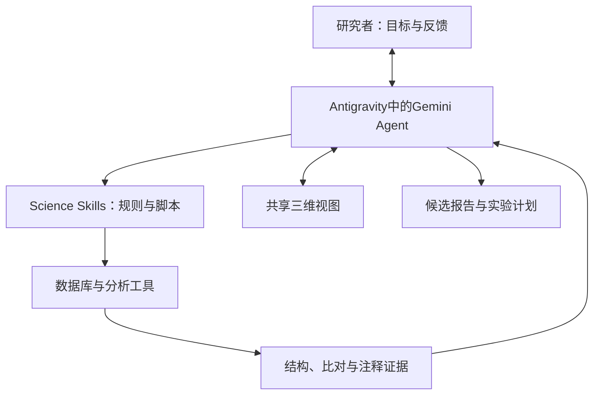

# Google Antigravity 抗菌肽发现工作流：Agent 架构、工具、代码与评估剖析

整理日期：2026-10-19  
范围：2026-10-15 Google DeepMind 官方 AMP 技术演示、Science Skills 开源组件、Antigravity 平台文档，以及用户提供的 ProtNLM 2022_04 推理 Notebook。

> 本文整理已核对的公开信息，并区分“案例实际展示”“平台通用能力”“开源组件能力”“分析推断”和“未披露”。未披露不代表没有实现；平台支持不代表本案例使用。开源仓库主分支会变化，本文没有固定其提交版本。本文未执行完整 AMP 案例，也未运行上传的模型权重。

## 1. 核心结论

这是一套研究者引导的、调用专业模型与数据库工具的科学 Agent 工作流。Antigravity 是工作平台，Gemini承担可见的交互与推理，ProtNLM提供蛋白功能注释线索，BLAST、Foldseek和结构数据库提供外部证据。

它的交付物是“天然候选分子、支持证据、待验证假设及实验计划”。它不是 AMPTailor 式的多属性从头生成器。公开材料没有证明这个 AMP 案例采用固定的多 Agent 团队，也未公开专门为 AMP 训练的 Agent 决策模型。

官方称候选正在湿实验验证；不能将计算合理性写成已验证抗菌活性、MIC、安全性或动物疗效。

## 2. 证据等级

| 标记 | 含义 |
|---|---|
| 案例确认 | 官方案例正文或演示截图明确说明 |
| 组件确认 | 开源技能源码或模型Notebook明确说明 |
| 平台支持 | 官方通用文档描述，但未证明案例启用 |
| 分析推断 | 基于公开组件关系的解释，不是官方内部设计 |
| 未披露 | 没有足够公开资料确定实现或参数 |

## 3. 总体架构

| 架构层 | 组成 | 职责 | 状态与边界 |
|---|---|---|---|
| 目标层 | 生物研究者 | 确定问题、物种范围和后续证据需求 | 案例确认 |
| 交互平台 | Antigravity | 承载会话、分析、文件与可视化 | 案例确认 |
| 决策模型 | Gemini | 理解任务、调用工具、解释结果 | 截图显示Gemini 3.8 Flash；精确后端配置未披露 |
| 专业模型 | ProtNLM | 序列到功能相关注释 | 案例介绍；是否现场运行未披露 |
| 工具知识层 | Science Skills | 工具用途、输入要求、执行方式、解释规则 | 开源配套；案例具体技能版本未披露 |
| 执行层 | 脚本、数据库接口和分析服务 | 检索、下载和比对 | 完整调用trace未公开 |
| 状态与反馈 | 对话、文件、共享结构视图 | 返回结果并接受研究者调整 | 案例确认到交互层 |
| 输出层 | 候选证据及实验计划 | 支持下一步实验决策 | 尚非完成的实验发现 |

以下是功能关系抽象，不是官方部署图：



## 4. 决策模型与控制逻辑

| 项目 | 可确认内容 | 未披露或不能推定的内容 |
|---|---|---|
| 总体目标制定 | 研究者提出 | 无自主选题评估 |
| 下一步分析 | 演示中研究者多次指示 | 无法认定端到端自主规划 |
| LLM身份 | 截图显示Gemini 3.8 Flash | 精确快照、路由、参数规模、温度 |
| AMP专项训练 | 未见公开说明 | 训练集、SFT、RL、奖励函数 |
| Planner | 有规划行为 | 独立Planner模型/进程未确认 |
| Executor | 有工具执行能力 | 独立Executor Agent未确认 |
| Critic/Verifier | 多类证据交叉检查 | 独立审查Agent未确认 |
| ReAct | 可抽象为行动—观察循环 | 没有特定ReAct实现证据 |
| 动态重规划 | 多轮对话可调整方向 | 自动触发条件和算法未披露 |
| 树搜索与回溯 | 未披露 | 分支、剪枝、候选计划评分 |
| 反思模块 | 未披露专门模块 | 不应把解释结果直接称为反思算法 |
| 工具路由 | 技能提供用途和边界描述 | 调度器内部实现和选择错误率 |
| 停止条件 | 案例以候选及计划结束 | 自动停止阈值与预算未披露 |
| 科学判定门槛 | 有生物学证据解释 | 缺少统一置信分数和硬门槛 |

架构判断：目前不宜画成固定的“Planner → Researcher → Critic → Experimenter”多Agent系统。多个工具或多个模型并不自动构成多Agent。

## 5. 数据库、模型与工具清单

| 组件 | 类别 | 输入 | 输出 | 作用与限制 |
|---|---|---|---|---|
| UniProtKB/TrEMBL | 序列与注释库 | 物种、注释、长度等条件 | 候选ID、序列和元数据 | 候选来源；完整查询式未给出 |
| UniProtKB/Swiss-Prot | 人工审校库 | 序列检索请求 | 已知蛋白匹配 | 检查已知同源性；不等于检索全部已知AMP |
| ProtNLM | 专业模型 | 蛋白序列 | 名称和功能相关注释 | 不是MIC或毒性预测器 |
| Gemini | 推理模型 | 用户任务和证据 | 操作与解释 | 科学结论需外部验证 |
| Antigravity | Agent平台 | 会话、文件、工具 | 工作过程与产物 | 平台不是单个生物预测模型 |
| EMBL-EBI NCBI-BLAST | 序列搜索服务 | 序列、库和参数 | 序列比对命中 | 案例参数和完整结果未公开 |
| AlphaFold DB | 预测结构库 | UniProt ID | 已有结构与相关数据 | 获取结构不等于重新运行AlphaFold |
| Foldseek | 结构搜索工具 | PDB/mmCIF等结构文件 | 结构相似命中 | 案例数据库版本和阈值未公开 |
| 结构叠合 | 结构分析 | 查询与参考结构 | 叠合结果 | 精确软件与参数未披露 |
| 基因邻域分析 | 上下文分析 | 基因坐标和邻近区域 | 邻近基因证据 | 数据源和API未明确 |
| 文献检索 | 知识获取 | 家族、机制和谱相关问题 | 文献与假设 | 具体检索系统未披露 |
| Biomolecular Structure Viewer | 可视化 | 结构、残基选择与标注 | 共享三维视图 | 可把用户标注反馈给Agent |

不能认定本案例使用了APD、DRAMP、DBAASP、ChEMBL、PubChem、AlphaGenome或特定PDB快照。平台支持其中一些资源，并不构成案例使用证据。

## 6. 案例工作流的解释边界

| 阶段 | 公开的功能 | 可支持的判断 | 不足以支持的判断 |
|---|---|---|---|
| 候选发现 | 查询天然序列及预测注释 | 有值得研究的候选 | 已完成从头设计 |
| 序列检查 | 与审校蛋白比对 | 已知序列关系 | 绝对新颖或具有新机制 |
| 结构检查 | 已有预测结构与远缘相似性 | 功能家族线索 | 已证明抗菌作用 |
| 邻域检查 | 周围转运及调控相关基因 | 与细菌素系统相容 | 确定活性、MIC或毒性 |
| 文献整合 | 推断作用机制和靶谱 | 待检验假设 | 已测得机制和靶谱 |
| 实验规划 | 形成验证方向 | 推动实验安排 | 自动执行湿实验 |
| 验证状态 | 官方称正在进行 | 有后续实验环节 | 已公布命中率或动物疗效 |

ProtNLM使用方式仍有一项关键未知：文章未提供日志区分“现场对序列推理”和“检索数据库中预先生成的注释”。

## 7. Science Skills的工程实现

### 7.1 UniProt技能

| 项目 | 已公开内容 |
|---|---|
| 位置 | skills/uniprot_database/SKILL.md |
| 执行封装 | Python脚本，例如scripts/uniprot_tools.py |
| 操作 | get、search、stream、count、sparql、map |
| 数据范围 | UniProtKB、UniParc、UniRef等 |
| 分页 | search支持自动分页 |
| 小规模检查 | 建议先用少量结果验证查询 |
| 回退策略 | 名称检索、UniParc、ID映射等 |
| 任务边界 | 数据访问不代替相似性搜索和结构预测 |
| 证据约束 | 要求依据工具输出，不编造序列和功能 |
| 工程意义 | 用技能说明和脚本降低LLM自由构造请求的错误 |

### 7.2 AlphaFold数据库技能

| 项目 | 已公开内容 |
|---|---|
| 位置 | skills/alphafold_database_fetch_and_analyze/SKILL.md |
| 输入 | UniProt accession |
| 下载 | mmCIF、PAE和API元数据 |
| 脚本 | fetch_structure.py、analyze_plddt.py、analyze_pae.py |
| 分析 | 结构置信度、无序、结构域与域间灵活性的启发式判断 |
| 回退 | 包含大蛋白片段等处理 |
| 报告要求 | 说明异构体、超长蛋白及低置信度问题 |
| 边界 | 不为自定义序列重新运行AlphaFold |
| 工程意义 | 确定性脚本负责指标计算，Agent负责解释 |

pLDDT和PAE反映预测结构的不同不确定性，不是AMP活性或功能的置信概率。

### 7.3 Foldseek技能

| 项目 | 已公开内容 |
|---|---|
| 位置 | skills/foldseek_structural_search/SKILL.md |
| 输入 | 本地.pdb、.cif或.mmcif文件 |
| API | Foldseek搜索服务 |
| 检查 | 文件类型、路径和数据库白名单 |
| 输出 | Markdown报告及JSON详情 |
| 默认执行示例 | uv run scripts/search.py STRUCTURE -o RESULTS.json |
| 数据库选项 | 公开技能列有afdb50、afdb-swissprot、pdb100等 |
| 边界 | 不直接接收序列或名称作为结构搜索输入 |
| 工程意义 | 通过文件产物连接结构获取与结构搜索 |

这些是当前开源技能能力，不是对演示每次工具调用的重建。许可通知、输入校验属于工程治理，不等于科学正确性评估。

## 8. 记忆、状态和执行机制

| 维度 | 确认情况 | 缺失信息 |
|---|---|---|
| 会话状态 | 支持多轮分析 | 压缩、截断、检索策略 |
| 共享视觉状态 | 结构选择和标注可反馈 | 状态schema和同步协议 |
| 文件产物 | 技能保存结构、JSON与报告 | 案例完整文件清单 |
| 长期记忆 | 案例未明确描述 | 向量库、跨会话记忆 |
| 候选对象管理 | 同一候选被连续分析 | 候选schema、版本与血缘 |
| 缓存 | 未披露案例设计 | 请求和模型结果缓存 |
| 重试 | 个别工具有回退与限速处理 | 全局超时与重试政策 |
| 失败恢复 | 部分技能有指导 | 自动换路线的调度逻辑 |
| 调用协议 | 有技能与脚本 | 是否MCP、RPC或终端调用 |
| 运行隔离 | 未能从案例确认 | 容器、沙箱与权限 |
| 日志 | 平台展示过程与产物 | 完整原始调用trace |
| 版本固定 | 可访问开源组件 | 演示commit与数据库快照 |
| 成本 | 未报告 | token、API费、总时长和人工时长 |

## 9. 平台支持的多Agent架构：不能直接套入AMP案例

Antigravity另有Teamwork通用能力。官方文档列出的角色如下：

| 角色 | 职责 | AMP案例是否证实使用 |
|---|---|---|
| Sentinel | 接收批准的任务、路由、进度通知与结束前审查安排 | 未证实 |
| Project Orchestrator | 划分里程碑、分派并行任务与交接 | 未证实 |
| Explorers | 只读研究和探索 | 未证实 |
| Workers | 实现代码、修改文件与测试 | 未证实 |
| Critic | 独立检查正确性、完整性、鲁棒性和接口 | 未证实 |
| Challenger | 边界、失败路径与压力测试 | 未证实 |
| Auditor | 完整性及执行检查，按平台规则工作 | 未证实 |
| Success Auditor | 最终成功标准检查 | 未证实 |

Teamwork文档还描述独立目录、文件所有权、结构化交接和验证门槛。它证明平台具备多Agent能力，不证明AMP演示用了这套团队。

平台还支持计划产物、行内反馈、审查政策等；这些通用功能与案例使用情况应分开记录。

## 10. 评估证据逐项核查

| 评估层 | 是否公开 | 能说明什么 | 不能说明什么 |
|---|---|---|---|
| 序列同源检查 | 案例展示 | 支持序列关系判断 | 不能单独证明新功能 |
| 结构相似性 | 案例展示 | 支持家族假设 | 不代替活性实验 |
| 基因邻域 | 案例展示 | 生物学上下文合理性 | 不确定效力和毒性 |
| 机制与靶谱 | 文献推断 | 提供假设 | 不是实验结果 |
| 湿实验 | 正在进行 | 有验证安排 | 无已公开完整命中率 |
| 动物实验 | 未见案例结果 | — | 不能声称动物疗效 |
| Agent任务成功率 | 未见 | — | 无法量化可靠性 |
| 重复运行 | 未见 | — | 无法判断稳定性 |
| 人工或普通LLM基线 | 未见系统比较 | — | 无法量化增益 |
| 模块消融 | 未见 | — | 无法做贡献归因 |
| 工具调用正确率 | 未见 | — | 无法量化参数或路由错误 |
| 科学推理评分 | 未见独立体系 | — | 无法量化假设正确率 |
| 效率 | 定性描述 | 潜在流程价值 | 无标准化计时统计 |
| 失败案例 | 未系统报告 | — | 适用边界未知 |
| 复现 | 部分组件公开 | 可复用工具 | 不是端到端复现 |

“验证候选的证据”与“评估Agent能力”是两个问题。存在多数据库证据不等于已经验证Agent优于人工或其他系统。

## 11. 开源与复现范围

| 内容 | 状态 |
|---|---|
| Science Skills说明、脚本、参考资料 | 公开 |
| 部分数据库和结构工具封装 | 公开 |
| ProtNLM 2022_04推理Notebook及其下载入口 | 公开旧版示例 |
| 本次ProtNLM精确版本 | 未确认 |
| Gemini决策权重 | 上述仓库不提供 |
| Antigravity核心运行时源码 | Science Skills不提供 |
| AMP案例完整系统提示词 | 未见公开 |
| 完整工具日志和中间结果 | 未见公开 |
| 一键复现入口和固定环境 | 未找到案例专用包 |
| AMP专项Agent训练与评估代码 | 未找到 |

复用组件可行；严格复现还需要固定模型、技能提交、数据库版本、查询参数、完整trace、筛选规则与全部结果。

## 12. 上传的ProtNLM Notebook解析

### 12.1 文件与任务

上传TXT实际为nbformat 4的Notebook JSON。source是代码，outputs是历史输出，metadata是环境和界面信息。已有血红蛋白结果不是本次重新运行结果。

功能：输入氨基酸序列，加载预训练模型，返回多个英文蛋白名称及分数。不包含Agent调度、BLAST、Foldseek、MIC预测、毒性预测或训练流程。

### 12.2 执行步骤

1. 安装TensorFlow 2.8.2和tensorflow-text 2.8.2。
2. 定义输入任务格式。
3. 下载SavedModel及参数文件。
4. 加载serving_default接口。
5. 输入序列，解码名称并处理分数。
6. 显示候选文本。

源码建议至少20 GB系统内存，不是明确要求20 GB显存。旧依赖能否在当前环境运行需要另行验证。

### 12.3 输入格式

```python
def query(seq):
    return f"[protein_name_in_english] <extra_id_0> [sequence] {seq}"
```

| 标记 | 作用 |
|---|---|
| [protein_name_in_english] | 指定英文蛋白名称任务 |
| <extra_id_0> | 特殊标记，输出清理时也会处理 |
| [sequence] | 标识氨基酸序列 |

生成对象是名称文本，不是新蛋白序列。仅凭特殊标记不能确定完整网络架构。

### 12.4 权重和接口

```text
protnlm/
├── saved_model.pb
└── variables/
    ├── variables.index
    └── variables.data-00000-of-00001
```

```python
imported = tf.saved_model.load(export_dir="protnlm")
infer = imported.signatures["serving_default"]
labeling = infer(tf.constant([query(seq)]))
names = labeling["output_0"][0].numpy().tolist()
scores = labeling["output_1"][0].numpy().tolist()
```

Notebook没有展示训练数据处理、损失函数、模型层数或参数量。说明称其与2022_04发布时模型非常相近，不等于2026年版本。

### 12.5 名称与分数

代码反转名称及对应分数顺序，把字节字符串解码，删除特殊标记，并对返回分数执行np.exp。

不能把0.364直接解释为功能正确率36.4%。Notebook未给出足以判断长度归一化、校准方式和概率语义的定义。

示例有10个候选，变量和路径提示多候选解码，但具体beam配置封装在模型中。10个名称可能是同义词、不同粒度或只描述某个结构域，不等于10种独立功能。

### 12.6 代码问题

| 问题 | 影响及改进方向 |
|---|---|
| 只去掉普通空格 | 需要处理FASTA标题、换行和制表符 |
| 无序列校验 | 检查空输入、大小写及非法字符 |
| EC正则点号未转义 | 应使用字面点，并检查完整匹配 |
| 直接反转输出 | 应确认接口顺序，必要时名称与分数成对排序 |
| wget -nc | 可能保留已有损坏文件 |
| 关闭证书校验 | 应恢复校验并验证下载完整性 |
| 旧依赖固定 | 需要独立兼容环境 |
| 无批处理与导出 | 不适合直接用于大型FASTA |
| 无置信度拒绝规则 | 模糊名称仍会被输出 |

给EC编号加前缀只是字符串处理，不代表查询或验证了EC数据库。该模型可提供未表征蛋白的初步线索；没有证据支持用它替代短肽MIC、安全性判别器，也不能单独判定GH9内切/外切活性。

## 13. 与AMPTailor的关系和可借鉴点

| 维度 | Antigravity AMP案例 | AMPTailor |
|---|---|---|
| 候选来源 | 天然蛋白数据库 | 从头生成短肽 |
| 核心能力 | 工具组织与证据整合 | 可组合属性控制 |
| 模型角色 | Gemini调度、ProtNLM注释 | 肽语言模型及属性条件引导 |
| 输出 | 候选、证据、假设和计划 | 按规格生成的序列及评估 |
| 可衔接关系 | 可调用生成器和判别器 | 可作为Agent的生成工具 |
| 实验结论 | 案例验证进行中 | 具体结论应以用户实际数据为准 |

建议的工具接口是：生成、属性预测、序列相似性、结构分析、实验结果查询和报告。若开发Agent，应固定预算与任务集，并比较人工流程、固定流水线、普通LLM调用和Agent；报告严格属性满足率、多样性、工具正确率、成本、重复稳定性及实验命中率。

本说明不将尚未提供或完成分析的SEM、转录组、动物结果假定为阳性，也不声称已有完整机制闭环。

## 14. 来源与核对入口

1. [Google DeepMind官方AMP案例，2026-10-15](https://deepmind.google/blog/accelerating-antimicrobial-discovery/)
2. [Antigravity科学应用页](https://antigravity.google/use-cases/science)
3. [Science Skills官方仓库](https://github.com/google-deepmind/science-skills)
4. [UniProt技能](https://github.com/google-deepmind/science-skills/blob/main/skills/uniprot_database/SKILL.md)
5. [AlphaFold数据库技能](https://github.com/google-deepmind/science-skills/blob/main/skills/alphafold_database_fetch_and_analyze/SKILL.md)
6. [Foldseek结构搜索技能](https://github.com/google-deepmind/science-skills/blob/main/skills/foldseek_structural_search/SKILL.md)
7. [Teamwork多Agent文档](https://www.antigravity.google/docs/teamwork/)
8. [计划文档](https://www.antigravity.google/docs/plan/)
9. [产物审查文档](https://www.antigravity.google/docs/artifact-review/)
10. [Artifacts文档](https://antigravity.google/docs/artifacts)
11. [Google Research ProtNLM推理Notebook](https://github.com/google-research/google-research/blob/master/protnlm/protnlm_use_model_for_inference_uniprot_2022_04.ipynb)
12. [UniProt ProtNLM说明](https://www.uniprot.org/help/ProtNLM)

来源对应：案例与工具使用以1为主；平台能力以2、7–10为主；技能工程细节以3–6为主；Notebook代码分析以用户上传文件为直接依据，11提供官方入口。本文没有将导航栏上的其他模型或平台资源认定为AMP案例组件。

## 15. 后续仍需获取的关键材料

- AMP案例对应的技能commit和模型版本。
- 完整查询、比对、结构搜索参数与数据库版本。
- 原始提示词、工具调用trace和中间产物。
- 是否实时运行ProtNLM，以及具体调用接口。
- 全部候选、筛选淘汰记录与选择准则。
- 重复运行、基线、消融、成本与失败分析。
- 最终湿实验及动物结果（若后续开展和公开）。

在上述材料补齐前，最稳妥的定性是：公开组件较丰富的人机协作科学Agent演示，尚非具备完整端到端复现与系统评估的AMP Agent研究报告。

